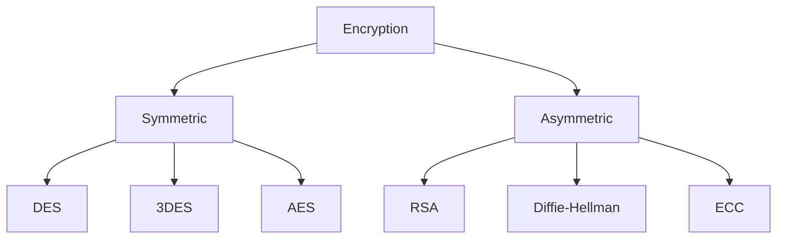

# 🔐 Learning Cryptography Basics

My personal notes on the fundamentals of cryptography.

## 📑 Table of Contents

1. [Why Cryptography Matters](#-why-cryptography-matters)
2. [Compliance & Regulations](#-compliance--regulations)
3. [Core Terminology](#-core-terminology)
4. [Plaintext to Ciphertext](#-plaintext-to-ciphertext)
5. [Historical Ciphers](#-historical-ciphers)
6. [Types of Encryption](#-types-of-encryption)
7. [Basic Math](#-basic-math)

---

## 🛡️ Why Cryptography Matters

- Ensures **secure communication in the presence of adversaries**.
- "Secure" means protecting the **confidentiality** and **integrity** of the communicated data.
- Cryptography is used to protect the **CIA Triad** (Confidentiality, Integrity, Availability).
- We rely on it every day. Almost all the technology we use is encrypted.

---

## 📜 Compliance & Regulations

Companies that handle sensitive data must follow specific standards and laws.

| Regulation | Full Name | Region | Covers |
|---|---|---|---|
| **PCI DSS** | Payment Card Industry Data Security Standard | Global | Credit card data |
| **HIPAA** | Health Insurance Portability and Accountability Act | 🇺🇸 USA | Medical records |
| **HITECH** | Health Information Technology for Economic and Clinical Health Act | 🇺🇸 USA | Medical records |
| **GDPR** | General Data Protection Regulation | 🇪🇺 EU | Personal data |
| **DPA** | Data Protection Act | 🇬🇧 UK | Personal data |
| **PDPA 2010** | Personal Data Protection Act 2010 | 🇲🇾 Malaysia | Personal data |

> 💳 **PCI DSS** sets a minimum security level for storing, processing and transmitting card data.
> Data must be encrypted **at rest** (while stored) and **in motion** (while transmitted).

---

## 📖 Core Terminology

| Term | Meaning |
|---|---|
| **Plaintext** | The original, readable message or data before encryption. Can be a document, image, multimedia file, or any binary data. |
| **Ciphertext** | The scrambled, unreadable result of encryption. Ideally reveals nothing about the plaintext except its approximate size. |
| **Cipher** | The algorithm or method that converts plaintext to ciphertext and back. Usually designed by a mathematician. |
| **Key** | A string of bits the cipher uses to encrypt or decrypt. The cipher is public knowledge, but the key must stay secret (except the public key in asymmetric encryption). |
| **Encryption** | Converting plaintext into ciphertext using a cipher and a key. |
| **Decryption** | The reverse of encryption. Recovering plaintext without the key should be infeasible. |

---

## 🔄 Plaintext to Ciphertext

**Encryption**

```
Sender (Plaintext)  ──►  Encrypt (Key)  ──►  Ciphertext
```

**Decryption**

```
Ciphertext  ──►  Decrypt (Key)  ──►  Plaintext (Recipient)
```

**Examples of plaintext:** simple text, photos, credit card information, medical health records.

---

## 🏺 Historical Ciphers

| Cipher | Era |
|---|---|
| Egyptian hieroglyph ciphers | ~1900 BCE, Ancient Egypt |
| **Caesar Cipher** | 1st century BCE |
| **Enigma** | World War II (used by Germany to encrypt its communications) |

### Caesar Cipher

Shift each letter of the message by a fixed number of positions.

- **Plaintext:** `TRYHACKME`
- **Key:** `3` (right shift of 3)
- **Ciphertext:** `WUBKDFNPH`

```
Plain:   A B C D E F G H I J K L M N O P Q R S T U V W X Y Z
Cipher:  D E F G H I J K L M N O P Q R S T U V W X Y Z A B C
```

- **Encrypt:** shift **right** by 3 (`XYZABCDE` → `ABCDEFGH`)
- **Decrypt:** shift **left** by 3 (`ABCDEFGH` → `XYZABCDE`)

---

## 🔑 Types of Encryption



### 1️⃣ Symmetric Encryption

- Also called **symmetric** or **private key** cryptography.
- The **same key** encrypts and decrypts, so keeping it secret is a must.
- Examples: **DES**, **3DES**, **AES**.

| Algorithm | Year | Key Size | Notes |
|---|---|---|---|
| **DES** (Data Encryption Standard) | 1977 | 56-bit | Broken in under 24 hours in 1999, which motivated the move to 3DES. |
| **3DES** (Triple DES) | — | 168-bit (112-bit effective security) | DES applied three times. An ad-hoc fix. Deprecated in 2019 but still found in legacy systems. |
| **AES** (Advanced Encryption Standard) | 2001 | 128 / 192 / 256-bit | The current standard. |

### 2️⃣ Asymmetric Encryption

- Also called **public key cryptography**.
- Uses a **pair of keys**: one to encrypt, the other to decrypt.
- Data encrypted with the **public key** can only be decrypted with the matching **private key**.
- Easy to compute in one direction, extremely difficult to reverse.
- **Slower** than symmetric encryption and uses **larger keys**.

```
Alice (Plaintext)  ──►  Encrypt (Bob's PUBLIC key)  ──►  Ciphertext
Ciphertext         ──►  Decrypt (Bob's PRIVATE key) ──►  Plaintext
```

| Algorithm | Recommended Key Sizes | Notes |
|---|---|---|
| **RSA** | 2048 / 3072 / 4096-bit | 2048-bit is the recommended minimum. |
| **Diffie-Hellman** | 2048 / 3072 / 4096-bit | 2048-bit minimum. Larger sizes for enhanced security. |
| **ECC** (Elliptic Curve Cryptography) | 256-bit | A 256-bit key gives security comparable to a 3072-bit RSA key. |

### ⚖️ Symmetric vs Asymmetric

| | Symmetric | Asymmetric |
|---|---|---|
| Keys | One shared secret key | Public + private key pair |
| Speed | ⚡ Fast | 🐢 Slower |
| Key size | Smaller | Larger |
| Examples | DES, 3DES, AES | RSA, Diffie-Hellman, ECC |

---

## ➕ Basic Math

Two operations come up constantly in cryptography: **XOR** and **modulo**.

### XOR (Exclusive OR)

Takes two bits and returns `1` if the bits are **different**, `0` if they are the **same**.

| A | B | A ⊕ B |
|:-:|:-:|:-----:|
| 0 | 0 | 0 |
| 0 | 1 | 1 |
| 1 | 0 | 1 |
| 1 | 1 | 0 |

**Example:** `1001 ⊕ 1010`

```
  1001
⊕ 1010
------
  0011
```

XOR can also be applied to letters by working on their binary values.

```python
print(0b1001 ^ 0b1010)        # 3
print(format(0b1001 ^ 0b1010, "04b"))  # 0011
```

### Modulo

- Written as `%` or `mod`.
- `X % Y` is the **remainder** when `X` is divided by `Y`.
- Python has this built in for integers.

| Expression | Result | Why |
|---|:-:|---|
| `25 % 5` | **0** | 25 = 5 × 5 + 0 |
| `23 % 6` | **5** | 23 = 3 × 6 + 5 |
| `23 % 7` | **2** | 23 = 3 × 7 + 2 |

```python
print(25 % 5)  # 0
print(23 % 6)  # 5
print(23 % 7)  # 2
```

#### Worked Example: `118613842 % 9091`

**Method: quotient and subtract**

1. Estimate `118613842 ÷ 9091 ≈ 13047.39`, then drop the decimal to get `13047`.
2. Multiply: `9091 × 13047 = 118,610,277`.
3. Subtract: `118,613,842 − 118,610,277 = 3565`.

✅ **Answer: `3565`**

> The remainder must always be smaller than the divisor (`3565 < 9091`).

---

<p align="center">⭐ Notes in progress. More to come as I keep learning. ⭐</p>
